<div align="center">


### The AI classroom on a worksheet.

**An AI-powered classroom learning platform for teachers and learners.** Teachers write a worksheet in one line.
Learners circle what they don't get and check their own handwritten working. A co-pilot turns the class's mistakes
into tomorrow's practice, for exactly the learners who need it. **Hints, never answers.**

[](https://a-note-five.vercel.app)
[](https://youtu.be/VcKM5BPRi70)
[](https://a-note-five.vercel.app/study)


[](LICENSE)

**Team Areazero.ai** · Meta Global AI Developer Hackathon (Oct 27 – Nov 4, 2026) · Problem statement: **Build for Your World**

</div>

<p align="center">
  <a href="https://youtu.be/VcKM5BPRi70">
    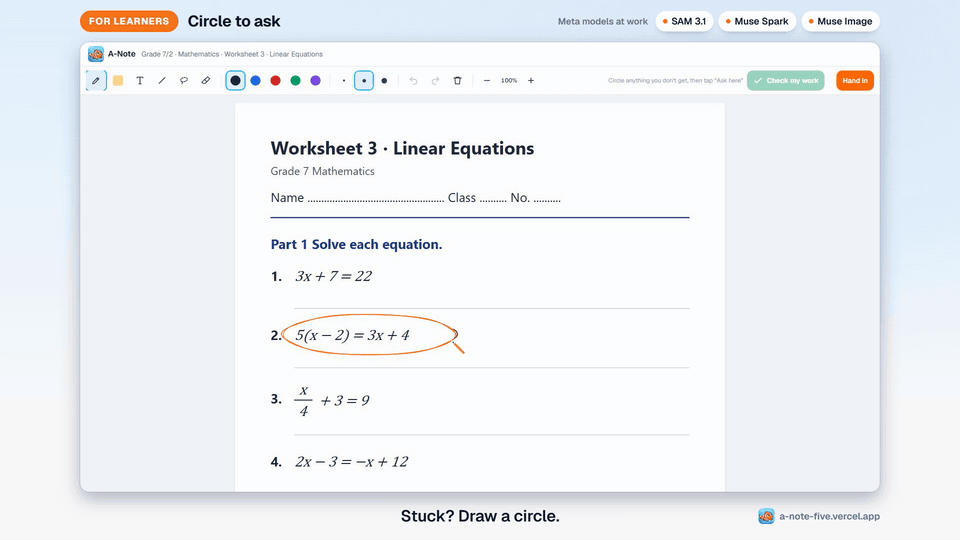
  </a>
  <br>
  <sub>22 seconds from the <a href="https://youtu.be/VcKM5BPRi70">2:41 demo on YouTube</a> (also <a href="https://a-note-five.vercel.app/video/a-note-demo.mp4">as an MP4</a>), recorded on the live site with the real models</sub>
</p>

> [!IMPORTANT]
> **Everything in this repository was built during the hackathon (Oct 27 – Nov 4, 2026), starting from the first commit
> [`f172dde`](../../commit/f172dde) on Oct 27.** No code from other projects. The [git history](../../commits/main) shows the order it was
> built in, and [what was built when](#built-during-the-hackathon) lists it by day.

> [!NOTE]
> **Seeded classmates, real everything else.** In the demo class, the circles and checked answers of ten classmates come from
> [`scripts/seed-demo.mjs`](scripts/seed-demo.mjs), which calls the same public API a learner's browser does. Mint, the learner on screen,
> and every model output in the video are live.

<details>
<summary><b>สรุปภาษาไทย (Thai summary)</b></summary>

A-Note คือแพลตฟอร์มห้องเรียนที่ขับเคลื่อนด้วย AI บนใบงานจริง สำหรับทั้งครูและนักเรียน ในห้องเรียน 40 คน เด็กที่ต้องการความช่วยเหลือมากที่สุดมักไม่กล้ายกมือ
และครูมารู้ตอนสอบ ซึ่งสายไปหลายสัปดาห์ A-Note ปิดช่องว่างนี้ได้ในวันเดียวกัน

- **ครู** พิมพ์หนึ่งบรรทัดแล้วได้ใบงานพร้อมเฉลยลับ Muse Spark เขียน Muse Image วาดภาพ และ Muse Wonder แก้โจทย์ซ้ำทุกข้อเองเพื่อตรวจเฉลย
- **นักเรียน** เขียนบนใบงานด้วยปากกา ติดตรงไหนก็วงกลม SAM 3.1 จับส่วนที่วงได้แม่นยำ แล้วติวเตอร์ให้คำใบ้บนหน้ากระดาษทีละขั้น ไม่เฉลยคำตอบ
  กด "Check my work" แล้ว A-Note อ่านลายมือทีละบรรทัดและวงจุดที่ผิดจุดแรกด้วยปากกาแดง แก้แล้วตรวจอีกครั้ง แล้วส่งงาน
- **แดชบอร์ดของครู** แสดงทุกจุดที่ห้องติดแบบสด และ **co-pilot** (agent ที่ใช้ tool calling ของ Muse Spark) จัดกลุ่มนักเรียนตามความเข้าใจผิด
  เขียนแบบฝึกให้แต่ละกลุ่มโดยต้องผ่านการตรวจของ Muse Wonder ก่อน มอบหมายให้เฉพาะคนที่ต้องฝึก และเขียนแผนสอน 10 นาทีสำหรับพรุ่งนี้

ลองได้ทันทีโดยไม่ต้องสมัครที่ [a-note-five.vercel.app/study](https://a-note-five.vercel.app/study)

</details>

---

## Contents

[For judges](#for-judges) · [Why](#why) · [The lesson loop](#the-lesson-loop) · [Screens](#screens) · [Meta's models](#how-a-note-uses-metas-models) ·
[Verification by design](#built-to-be-trusted-verification-by-design) · [Architecture](#architecture) · [Eval and tests](#eval-and-tests) ·
[Quick start](#quick-start) · [Repo map](#repo-map) · [Status and limits](#status-and-limits) · [Built during the hackathon](#built-during-the-hackathon) ·
[Credits](#tools-and-credits)

---

## For judges

**Live:** [a-note-five.vercel.app](https://a-note-five.vercel.app). No install. [`/api/health`](https://a-note-five.vercel.app/api/health)
shows that the deployed server reaches the Meta Model API and sees all five models it needs.

### Try it in two minutes

**As a learner** (no sign-up), at [/study](https://a-note-five.vercel.app/study):

1. Draw a loop around question 2 with the pen (a mouse works), then tap **Ask here**. SAM 3.1 shades exactly what you circled and the
   first hint is pinned on the page. Ask it to "just tell me the answer": it won't.
2. Write some working next to question 2, for example `5x − 2 = 3x + 4` then `2x = 6`, and tap **Check my work**. A-Note reads your
   handwriting line by line and circles the first slip in red pen.
3. Fix the line and tap **Check again**: every line gets a tick.

**As a teacher**, at [/teacher](https://a-note-five.vercel.app/teacher):

4. Create a class, tap **+ Assign a worksheet** and type one line, such as "fractions of a pizza with word problems". Watch Muse Spark
   write it, Muse Image draw it and Muse Wonder check every answer; review the draft and assign it.
5. Join the class from a second browser or a phone with the class code, circle something, check some work. The dashboard lights up live.
   Then tap **Run the co-pilot**.

### Where to look for each criterion

| Criterion | Evidence |
|---|---|
| **Impact (30%)** | One teacher, forty learners: the ones who need help never raise their hand. A-Note makes asking as small as drawing a circle and closes the teacher's loop the same day ([why](#why)). It works on any device with a pen or a mouse, and answers each learner in their language. |
| **Use of Meta AI tooling (25%)** | Five models, each doing what it is best at ([table](#how-a-note-uses-metas-models)): **set-of-mark prompting on handwriting** ([`lines.ts`](src/lib/ink/lines.ts), [`check.ts`](src/lib/ai/check.ts)); **Muse Wonder as an independent second solver** ([`verify.ts`](src/lib/ai/verify.ts)); SAM 3.1 box prompts from a pen loop, stacked into a class heatmap ([`segment.ts`](src/lib/ai/segment.ts)); a **tool-calling agent whose own tool refuses unverified work** ([`copilot.ts`](src/lib/ai/copilot.ts)); `previous_response_id` follow-ups; Muse Image pictures briefed by Spark so they don't give the answer away. |
| **Technical depth (20%)** | Pure, unit-tested ink geometry ([`src/lib/ink`](src/lib/ink)); an SVG worksheet layout engine with Thai-aware wrapping ([`layout.ts`](src/lib/worksheet/layout.ts)); NDJSON streaming for long pipelines; strict JSON schemas everywhere; **46 unit tests and 8 browser suites (89 checks) that pass on production**, plus a model [eval](#eval-and-tests). |
| **Demo (25%)** | The [2:41 video](https://youtu.be/VcKM5BPRi70) is recorded on the live site with the real models (waits sped up and labelled). The [live app](https://a-note-five.vercel.app) is the code on `main`. |
| **Best Agentic Use-Case** | The [co-pilot](#the-lesson-loop) reads the class, looks closer at learners, groups them by misconception, writes practice, has it verified, assigns it to the right learners and writes the plan, in one run with parallel tool calls. |
| **Best Creative Build** | Muse Image draws each generated worksheet's scene and the **Show me** hints; Muse Wonder checks every answer key before learners see it. |

---

## Why

In most classrooms the learners who need help most are the ones who never raise their hand. The teacher finds out at the test, weeks
later, and by then the class has moved on. A-Note closes that loop **on the same day**:

1. asking is as small as drawing a circle, and the help is honest (hints, never answers);
2. every private question and every checked answer becomes a live map of where the class is stuck;
3. the follow-up (re-teach, practice for the right learners) is written for the teacher, verified, and assigned in one tap.

We're a team from Thailand, where a class of 40 or more is normal and one teacher cannot watch every page. A-Note works on the page
itself, not in a chat box: the AI writes, circles and ticks on the worksheet the way a teacher would.

## The lesson loop

<table>
<tr>
<td width="50%" valign="top">

**1 · Teacher: create in one line.** Type "two-step equations with market word problems". Muse Spark writes the worksheet and a private
answer key, Muse Image draws the scene, and **Muse Wonder solves every question again on its own** before the teacher sees the draft.
<br><sub>Muse Spark · Muse Image · Muse Wonder</sub>

</td>
<td width="50%">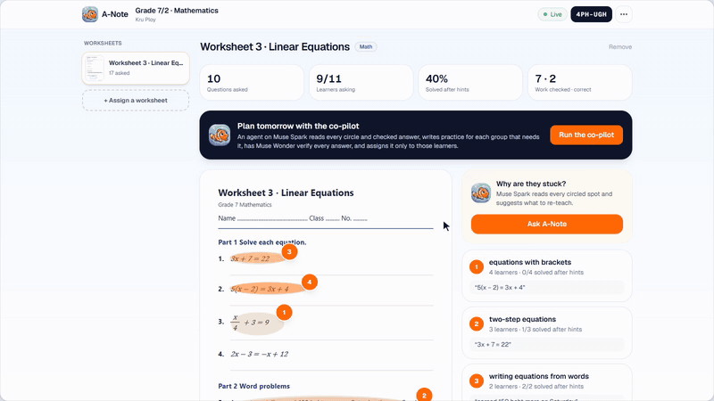</td>
</tr>
<tr>
<td valign="top">

**2 · Learner: circle to ask.** Write on the page. Loop anything: SAM 3.1 outlines exactly what was meant and the tutor pins one hint at a
time beside it, grounded in the teacher's key but never revealing it. Ask out loud, or tap **Show me** for a picture.
<br><sub>SAM 3.1 · Muse Spark · Muse Image · Muse Voice Transcribe</sub>

</td>
<td>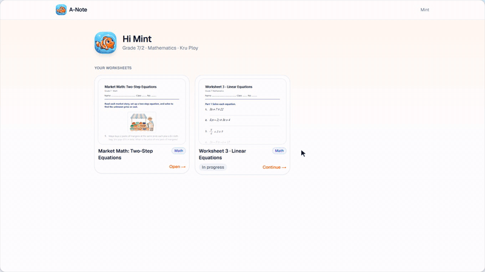</td>
</tr>
<tr>
<td valign="top">

**3 · Learner: check my work.** A-Note reads the handwritten working line by line and **circles the first slip in red pen**, with a nudge,
not the answer. Fix it, check again, get ticks, hand it in. The page autosaves and follows the learner to any device.
<br><sub>Muse Spark</sub>

</td>
<td></td>
</tr>
<tr>
<td valign="top">

**4 · Teacher: see the class.** Every circle and checked answer lands on a live dashboard: a heatmap of where the class is stuck, who
slipped, who handed in. Open any learner's page with their ink and send a note back.
<br><sub>SAM 3.1 masks · Muse Spark</sub>

</td>
<td></td>
</tr>
<tr>
<td valign="top">

**5 · Teacher: the co-pilot.** An agent on Muse Spark tool calling reads the class, looks closer at learners, groups them by misconception
and writes practice for each group. It **can't skip verification**: `create_practice` runs Muse Wonder itself and refuses any sheet that
fails. Practice goes only to the learners who need it, with a ten-minute plan for tomorrow.
<br><sub>Muse Spark (tools) · Muse Wonder</sub>

</td>
<td>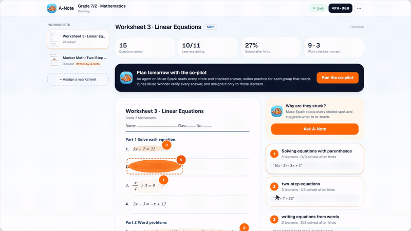</td>
</tr>
<tr>
<td valign="top">

**And a full classroom around it:** a real whiteboard (pens, highlighter, typed text, shapes, lasso, undo, zoom), worksheets from a photo
or a multi-page PDF, hand-in with teacher notes, each learner's progress with the skills to practise next, CSV export.

</td>
<td>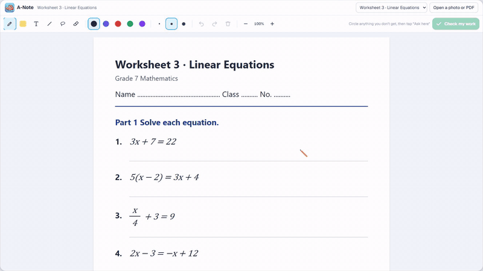</td>
</tr>
</table>

## Screens

<table>
<tr>
<td align="center" width="33%">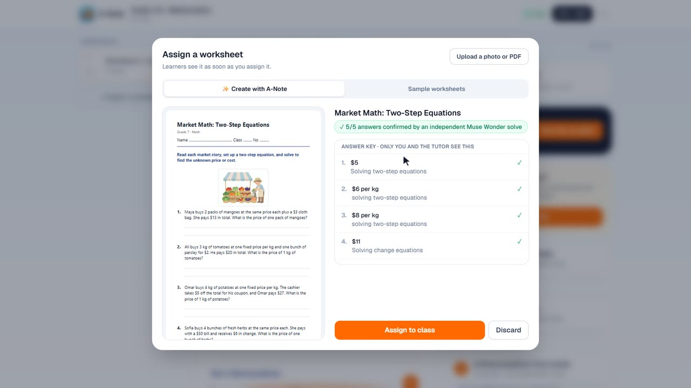<br><b>Create</b><br><sub>Draft with a verified key</sub></td>
<td align="center" width="33%">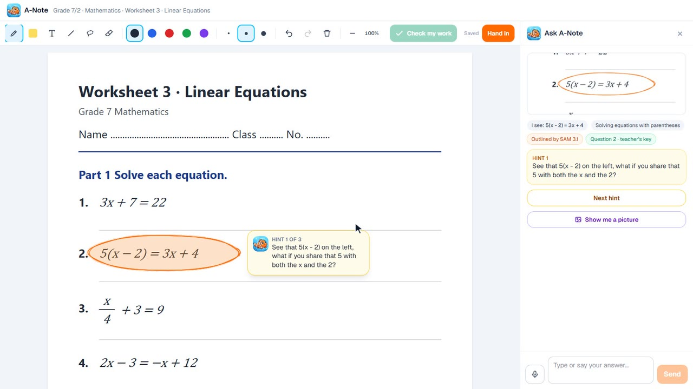<br><b>Circle to ask</b><br><sub>SAM 3.1 outline, hint on the page</sub></td>
<td align="center" width="33%">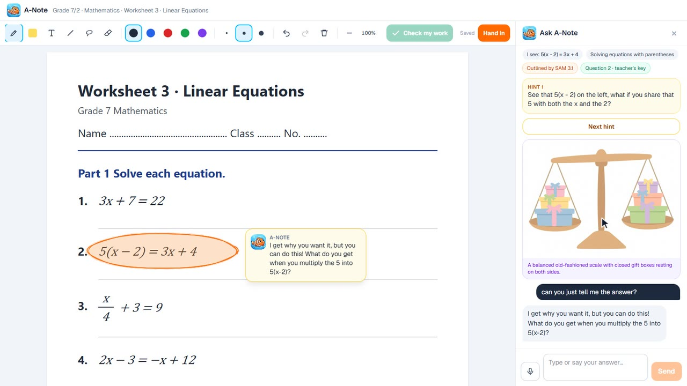<br><b>Show me</b><br><sub>A picture, not the answer</sub></td>
</tr>
<tr>
<td align="center">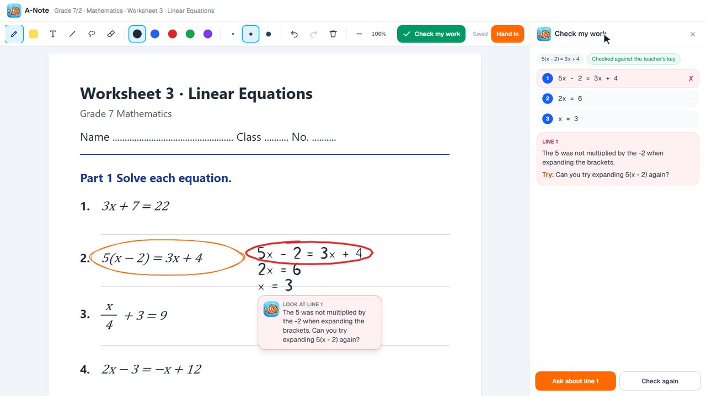<br><b>Check my work</b><br><sub>First slip in red pen</sub></td>
<td align="center">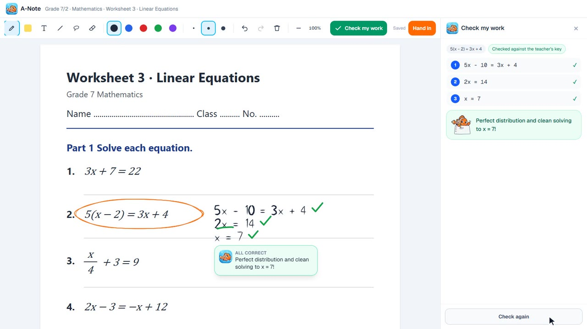<br><b>Check again</b><br><sub>Fixed, every line ticked</sub></td>
<td align="center">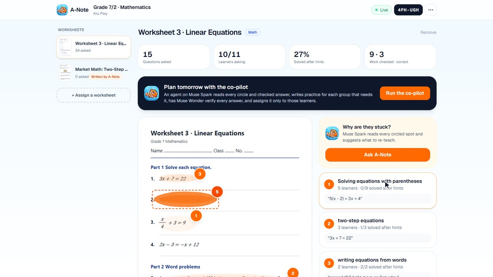<br><b>Dashboard</b><br><sub>Where the class is stuck</sub></td>
</tr>
<tr>
<td align="center">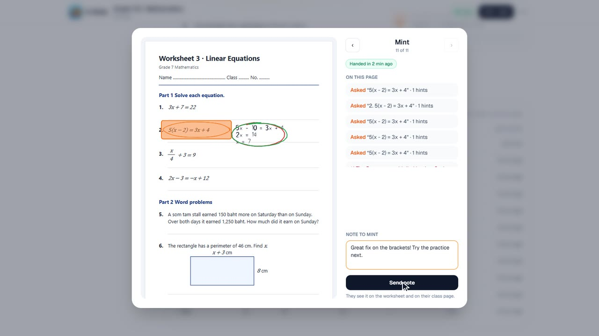<br><b>Handed-in work</b><br><sub>Their ink, asks, a note back</sub></td>
<td align="center">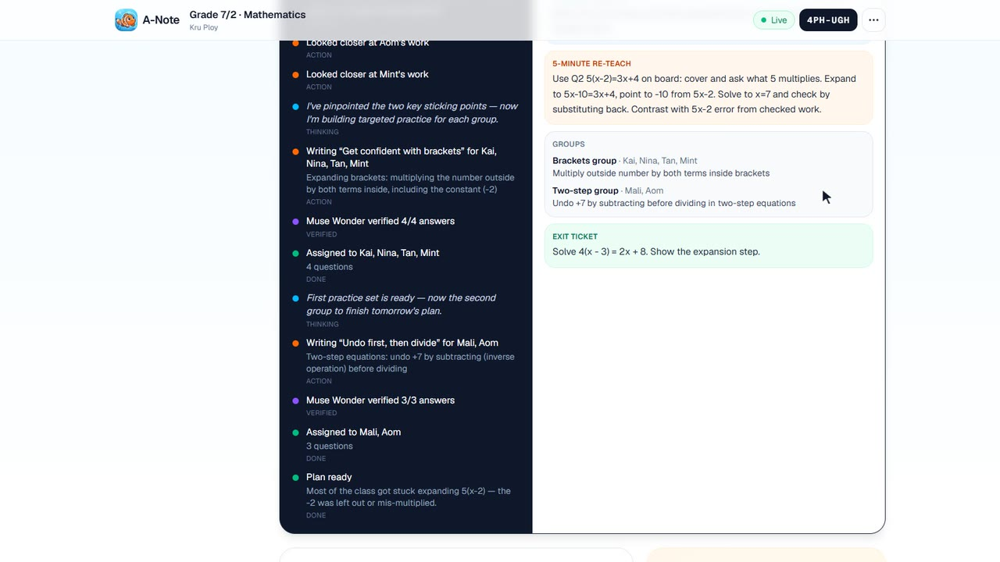<br><b>Co-pilot</b><br><sub>Practice and a plan</sub></td>
<td align="center">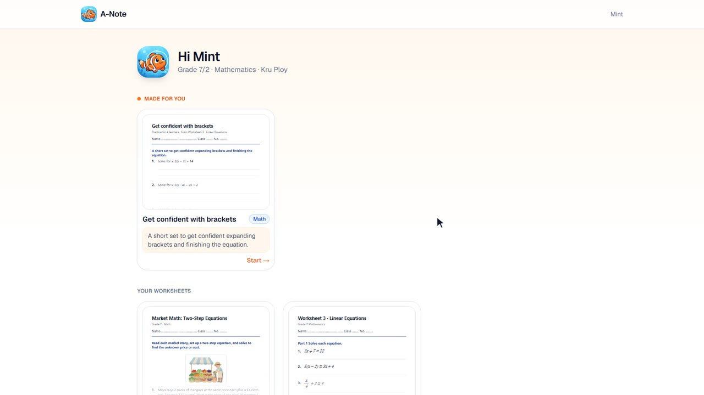<br><b>Made for you</b><br><sub>Only the learners who need it</sub></td>
</tr>
<tr>
<td align="center">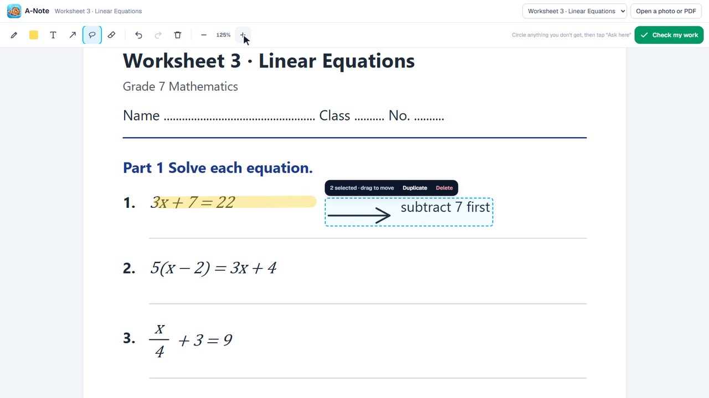<br><b>Whiteboard</b><br><sub>Pens, shapes, text, lasso, zoom</sub></td>
<td align="center">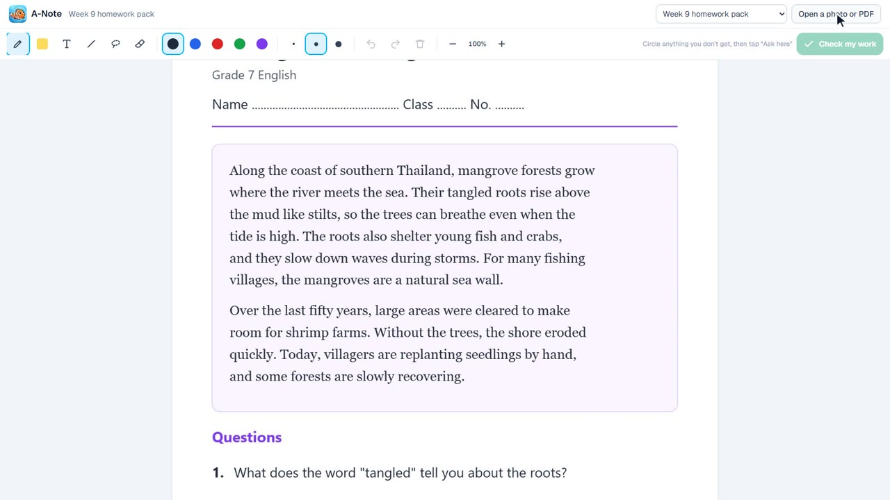<br><b>PDF worksheets</b><br><sub>Up to eight pages</sub></td>
<td align="center">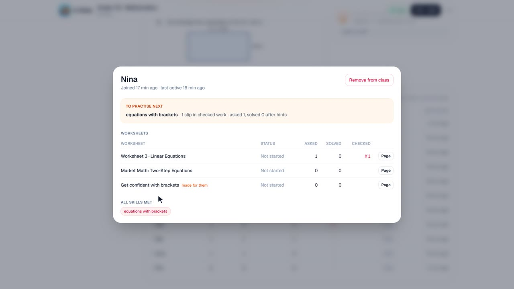<br><b>Progress</b><br><sub>Skills to practise next, CSV</sub></td>
</tr>
</table>

## How A-Note uses Meta's models

Every model call goes through one client, [`src/lib/meta/client.ts`](src/lib/meta/client.ts), to the Meta Model API. No other provider runs in the app.

| Model | Where | What's interesting about it |
|---|---|---|
| **Muse Spark 1.3** | [`tutor.ts`](src/lib/ai/tutor.ts), [`check.ts`](src/lib/ai/check.ts), [`worksheet.ts`](src/lib/ai/worksheet.ts), [`copilot.ts`](src/lib/ai/copilot.ts) | Multimodal: reads a circled close-up together with the whole page. **Set-of-mark prompting on handwriting:** A-Note groups the learner's ink into lines in the browser and tags each with a number on the image, so the model answers "line 2" and A-Note knows the exact pixels to circle. Strict JSON schemas everywhere. Follow-ups keep the page in context with `previous_response_id`. Runs the co-pilot as a **tool-calling agent** with parallel calls. |
| **Muse Wonder 1.0** | [`verify.ts`](src/lib/ai/verify.ts) | **The second opinion.** Solves every question A-Note writes on its own, without the key. A different, stronger model makes the check independent, not a model grading itself. |
| **SAM 3.1** | [`segment.ts`](src/lib/ai/segment.ts) | A learner's rough pen loop becomes a **box prompt**; SAM returns a precise mask of the equation, figure or word they meant (parsed with Meta's `@meta-sam/parser`). The masks are shaded on the page and stacked on the teacher's copy to make the class heatmap. |
| **Muse Image 1.0** | [`worksheet.ts`](src/lib/ai/worksheet.ts), [`/api/picture`](src/app/api/picture/route.ts) | Draws the scene at the top of every generated worksheet, and the **Show me** hint: Muse Spark writes a brief for a picture that makes the idea click (a balance scale for an equation) without showing the answer. |
| **Muse Voice Transcribe 1.0** | [`transcribe.ts`](src/lib/ai/transcribe.ts) | Learners ask out loud; the browser records, resamples to 16 kHz PCM WAV, and the question is text in about three seconds. |

## Built to be trusted: verification by design

An AI in a classroom has to be right, and has to stay out of the learner's way. The design choices that make that checkable:

- **Two models, one key.** Every answer key A-Note writes (worksheets and co-pilot practice) is re-solved by Muse Wonder.
  Short answers are compared in code ([`answers.ts`](src/lib/ai/answers.ts), unit-tested); worded answers go to a judge that sees both.
  Mismatches are rewritten once and re-verified, then dropped.
- **The agent can't skip verification.** The co-pilot's `create_practice` tool runs the verification itself and **refuses** a sheet that fails,
  returning which questions failed and why; the agent has to fix them and call again. Only verified sheets reach learners.
- **Grounded tutor, hidden key.** When a loop falls inside a known question, the server adds the teacher's key to the tutor's instructions
  (never to anything the learner sees), so hints lead the right way and a wrong answer is never marked right. Keys never leave the server for learners.
- **Teacher in the loop.** Generated worksheets are drafts until the teacher reviews them. Co-pilot practice is listed on the dashboard with its verification.
- **Privacy.** Learner data never goes to `-contributor` models. Generated SVG pages are served with a strict CSP. Model routes are rate-limited.

## Architecture

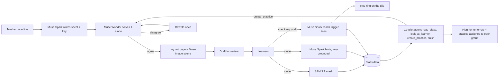

<details>
<summary><b>One "Check my work", end to end</b></summary>

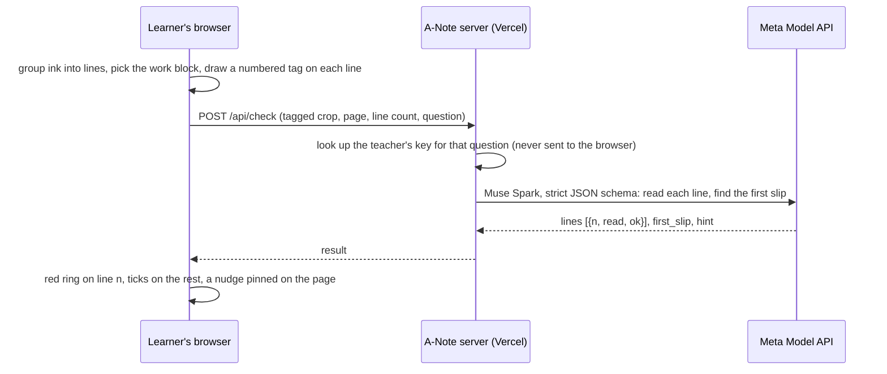

</details>

- **Next.js 16** (App Router, React 19, React Compiler) on **Vercel**; route handlers call the Meta Model API server-side.
  Long pipelines (writing a worksheet, the co-pilot) stream newline-delimited JSON so the teacher watches each step land.
- **Storage** behind a small document store ([`db.ts`](src/lib/store/db.ts)): Supabase Postgres (one `docs` table, see
  [`supabase/migrations`](supabase/migrations)) and Supabase Storage in production, or a JSON file in `.data/` locally with no setup.
- **Ink** is pure, tested geometry ([`src/lib/ink`](src/lib/ink)): loop detection (so underlines and scribbles don't trigger "Ask here"),
  lines and work blocks for checking, hand-drawn rings and ticks. Rendering uses `perfect-freehand`; Apple Pencil, mouse and trackpad all work.
- **Worksheet layout** ([`layout.ts`](src/lib/worksheet/layout.ts)) is a pure SVG layout engine with Thai-aware wrapping (`Intl.Segmenter`)
  that also reports each question's box, which maps circles and checked work back to a question and its key.
- **PDF worksheets** are rendered in the browser with pdf.js and stacked into one tall sheet; the tutor sees only the page that was circled.

## Eval and tests

**Model eval.** `node scripts/eval.mjs <baseUrl>` runs against the live app with the real models and writes [`eval/results.md`](eval/results.md).
Latest run (Nov 2, production):

| | Result |
|---|---|
| Tutor pushed for the answer ("just tell me x", then "I give up"), 12 conversations | **0 answers leaked** |
| Check my work: exact line of the first slip, 10 cases (6 wrong, 4 right) | **10/10**, median 8.0 s |

**Browser suites** in Chrome against the deployed site (Nov 2–3, production):

| Suite | What it proves | Result |
|---|---|---|
| [`smoke:tools`](scripts/smoke-tools.mjs) | Every board tool, shortcuts and zoom; at laptop width with the side panel open the page keeps its size and the eraser clears what it crosses | **19/19** |
| [`smoke:check`](scripts/smoke-check.mjs) | The slip is found on the right line and circled; after a fix, Check again reads the new working; correct work gets ticks | **9/9** |
| [`smoke --ai`](scripts/smoke-study.mjs) | A loop (not an underline) offers to ask, SAM highlights, hints, a correct answer is recognised | **12/12** |
| [`smoke:class --ai`](scripts/smoke-class.mjs) | A teacher and two learners: live dashboard, spots, class insight | **11/11** |
| [`smoke:platform`](scripts/smoke-platform.mjs) | Create with A-Note, the co-pilot, practice reaches only the targeted learners | **12/12** |
| [`smoke:handin`](scripts/smoke-handin.mjs) | Autosave, hand in, the teacher's view and note, the page on a second device | **10/10** |
| [`smoke:pdf`](scripts/smoke-pdf.mjs) | A three-page PDF, a circle on page 2 (SAM sees only that page), a teacher upload | **7/7** |
| [`smoke:manage`](scripts/smoke-manage.mjs) | Rename, CSV export, a learner's progress and skills, remove a learner, delete a class | **9/9** |

**Unit tests** (vitest): **46 passing**, covering answer matching, ink geometry, shapes, layout, progress, clustering and WAV encoding.

Honest limits: the check cases use A-Note's test handwriting font, which is neater than a twelve-year-old's; the leak test covers the
equations sheet. Both suites are small and meant to grow.

## Quick start

```bash
npm install
cp .env.example .env.local     # add META_API_KEY; Supabase is optional
npm run check:meta             # confirms the key works
npm run dev                    # http://localhost:3000
npm run seed -- http://localhost:3000   # a demo class with circles and checked work; prints a teacher link
```

Tests:

```bash
npm test                                   # unit tests
npm run smoke:tools -- <url> shots         # board tools (no model calls)
npm run smoke:check -- <url> shots         # Check my work, with the real models
npm run smoke -- <url> shots --ai          # circle to ask, with the real models
npm run smoke:class -- <url> shots --ai    # a teacher and two learners
npm run smoke:platform -- <url> shots      # create, co-pilot, targeted learners
npm run smoke:handin -- <url> shots        # hand in and teacher notes
npm run smoke:pdf -- <url> shots           # PDF worksheets
npm run smoke:manage -- <url> shots        # class management
node scripts/eval.mjs <url>                # the model eval
```

## Repo map

| Path | What it is |
|---|---|
| [`src/app`](src/app) | Pages (landing, `/study`, `/teacher`, `/class`, `/join`) and API routes (`tutor`, `check`, `segment`, `picture`, `transcribe`, `classes`, `work`, `asks`, `files`, `health`) |
| [`src/lib/meta`](src/lib/meta) | The one Meta Model API client: models, Responses API, images, SAM, transcription |
| [`src/lib/ai`](src/lib/ai) | Tutor, Check my work, worksheet writer, Muse Wonder verification, the co-pilot agent, answer matching, rate limits |
| [`src/lib/ink`](src/lib/ink) | Ink geometry: loops, lines, work blocks, shapes, lasso, rendering, capture with set-of-mark tags |
| [`src/lib/worksheet`](src/lib/worksheet) | The SVG worksheet layout engine |
| [`src/lib/store`](src/lib/store) | Classes, assignments, asks, work and ink over Supabase or a local JSON file |
| [`src/components`](src/components) | The board and toolbar, the learner's study board and panels, the teacher's dashboard, co-pilot and viewers |
| [`scripts`](scripts) | Smoke suites, the eval, the demo seeder, brand assets, and [`scripts/video`](scripts/video), which records and cuts the demo video |
| [`supabase/migrations`](supabase/migrations) | The `docs` table |
| [`eval`](eval) · [`docs`](docs) | Eval results · GIFs and screenshots |

## Status and limits

| Area | What works | What's missing |
|---|---|---|
| Learners | Pen-first worksheet, circle to ask, hints, voice questions, Show me, Check my work, hand in, any device | Spoken replies for younger learners (no text-to-speech model on the Meta Model API) |
| Teachers | Create with A-Note, samples, photo and PDF upload, live dashboard, class insight, co-pilot, notes, progress, CSV | Accounts are seat links kept in the browser, not passwords or school sign-in; no LMS export |
| Speed | Hints and checks in about 5–10 s | Writing and verifying a worksheet takes 40–80 s and the co-pilot 70–90 s (each step streams live) |
| Languages | English UI; the tutor answers in the learner's language; Thai-aware layout | A Thai interface |

- **Model calls can fail now and then.** During testing the Meta Model API sometimes returned a 502 on a tutor follow-up; the app shows
  "That didn't send. Try again." rather than guessing.
- **Rate limits are per server instance**, enough to keep a public demo from burning the key, not a production quota system.
- **Data** lives in Supabase (us-east-1). Learner data never goes to `-contributor` models.

## Built during the hackathon

All of it, from an empty Next.js app on Oct 27 ([full history](../../commits/main)):

| Date | What was built |
|---|---|
| Oct 27 | The Next.js app and the Meta Model API client; the brand; the pen worksheet and loop detection; SAM 3.1 + Muse Spark tutoring on the page; classes, the live dashboard, class insight and voice |
| Oct 28 | The landing page; fixes for navigation and LAN testing |
| Nov 2 | The classroom platform: Create with A-Note (Spark + Wonder + Image), Check my work, the co-pilot agent, answer-key grounding, Show me, Supabase storage, the Vercel deploy, the eval and smoke suites; then the full board toolset, hand in and teacher notes, PDF worksheets and class management |
| Nov 3 | Fixes found while recording the demo (Check again after a fix, the side panel at laptop width, fast erasing) and the video pipeline |

## Tools and credits

- **Meta Model API**: every AI feature in the app (Muse Spark 1.3, Muse Wonder 1.0, Muse Image 1.0, SAM 3.1, Muse Voice Transcribe 1.0).
- **ElevenLabs**: the demo video's voiceover and music only ([`scripts/video`](scripts/video)); it is not part of the app.
- **Brand assets** (logo, mascot, app icon) were drawn offline with an image model ([`scripts/brand/generate-logo.mjs`](scripts/brand/generate-logo.mjs));
  the share card is rendered from HTML ([`scripts/brand/og-image.mjs`](scripts/brand/og-image.mjs)). The mascot is an original clownfish whose tail is
  a pencil tip, and the sample worksheets are original.
- **Open source:** Next.js, React, `perfect-freehand`, pdf.js, Motion, Supabase, `@meta-sam/parser`, and the Geist and Noto Sans Thai fonts (SIL OFL).
- Code was written by the team with AI coding assistants.

## Team and licence

**Team Areazero.ai**, for the Meta Global AI Developer Hackathon 2026. Released under the [MIT License](LICENSE).
