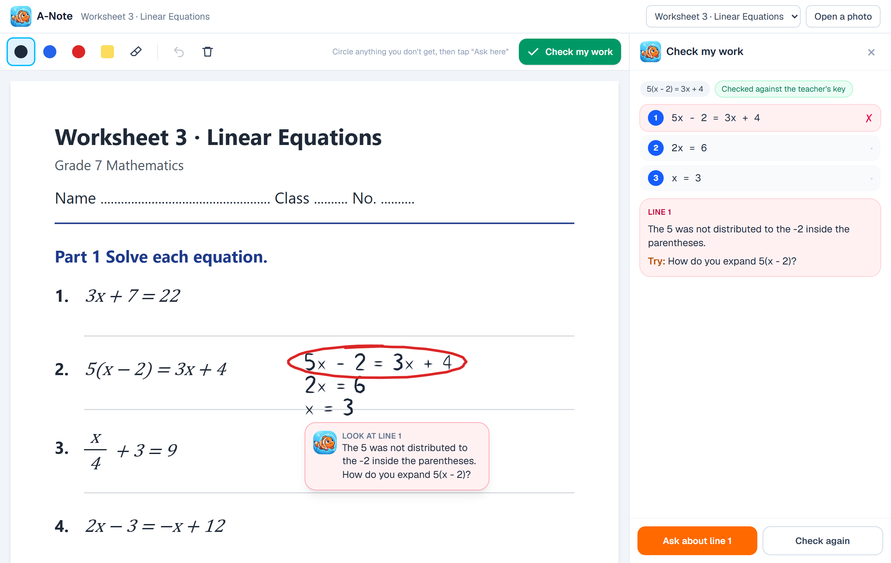
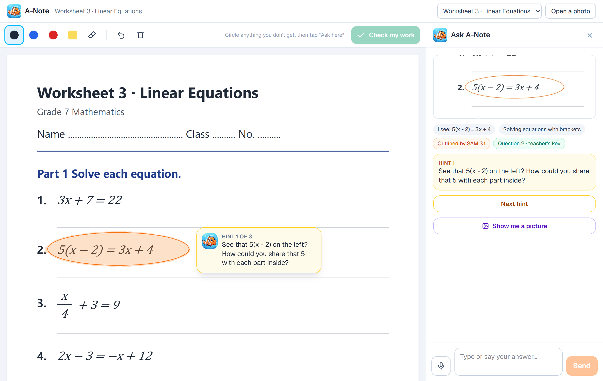
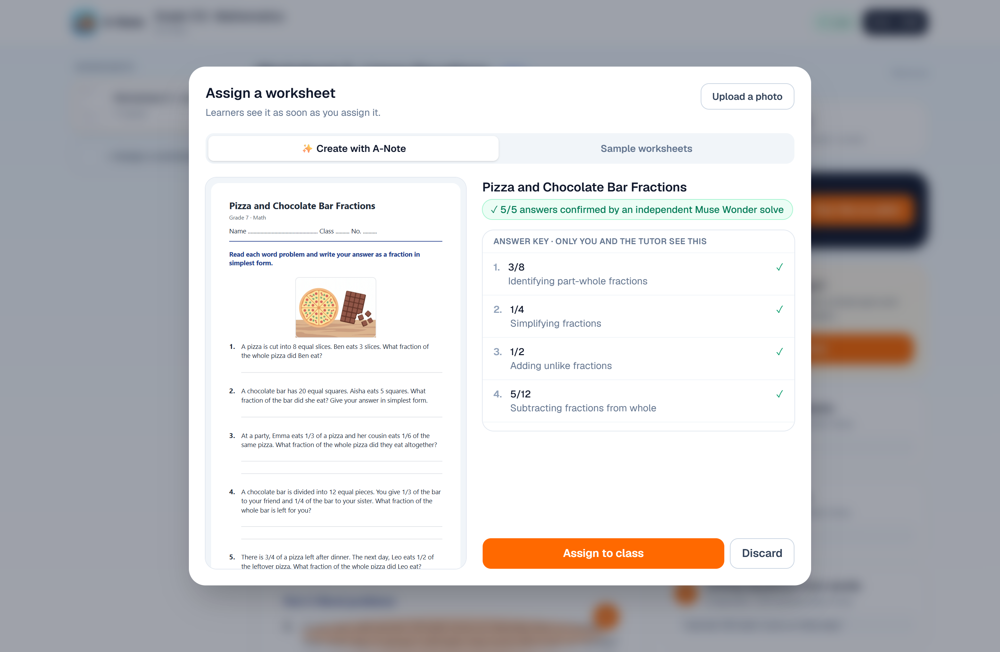
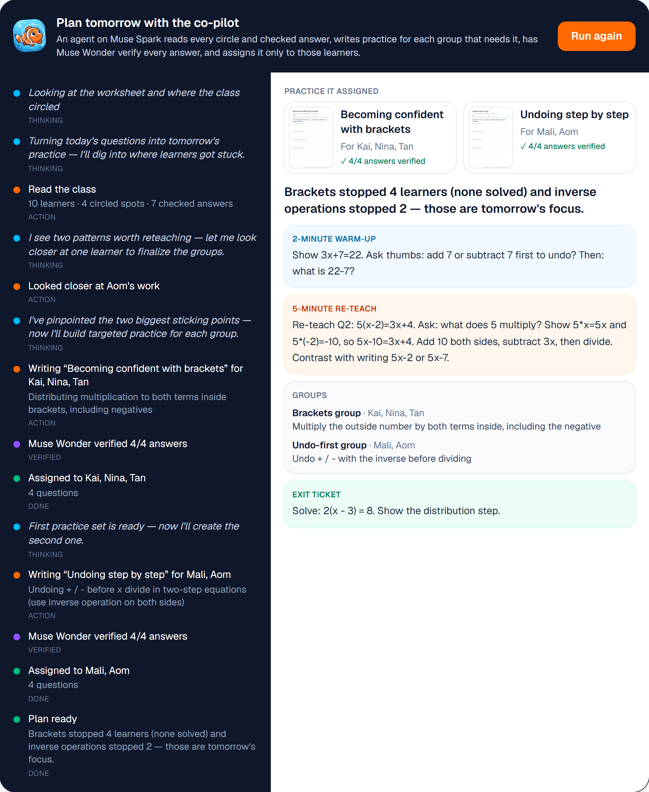
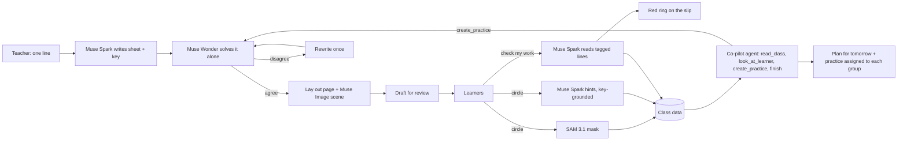

<p align="center"></p>

# A-Note

**The AI classroom on a worksheet.** Teachers write a worksheet in one line. Learners circle what they don't get and check their
own handwritten working. A co-pilot turns the class's mistakes into tomorrow's practice, for exactly the learners who need it.

**Live:** [a-note-five.vercel.app](https://a-note-five.vercel.app) · try it with no sign-up at [/study](https://a-note-five.vercel.app/study)
· Built for the [Meta Global AI Developer Hackathon](https://cerebralvalley.ai/e/meta-ai-developer-hackathon) · Problem statement: **Build for Your World**

> **Everything in this repository was written during the hackathon (Oct 27 – Nov 4, 2026), starting from the first commit
> ([`f172dde`](../../commit/f172dde)).** No code from other projects. The git history shows the order it was built in.

<p align="center"></p>

## Why

In most classrooms the learners who need help most are the ones who never raise their hand. The teacher finds out at the test,
weeks later, and by then the whole class has moved on. A-Note closes that loop **on the same day**:

1. asking is as small as drawing a circle, and the help is honest (hints, never answers);
2. every private question and every checked answer becomes a live map of where the class is stuck;
3. the follow-up (re-teach, practice for the right learners) is written for the teacher, verified, and assigned in one tap.

We're a team from Thailand, where a class of 40 or more is normal and one teacher cannot watch every page. A-Note is English by
default and answers each learner in their own language.

## The lesson loop

| | Who | What happens | Meta models |
|---|---|---|---|
| 1 | Teacher | **Create.** Type one line ("two-step equations with market word problems"). A-Note writes the worksheet and a private answer key, draws the scene, and **re-solves every question with a second model** before the teacher sees it. Or assign a sample or a photo. | Muse Spark, Muse Wonder, Muse Image |
| 2 | Learner | **Circle to ask.** Write on the page with a pen or a mouse. Loop anything: SAM 3.1 outlines exactly what was meant, and the tutor pins one hint at a time on the page, grounded in the teacher's key but never revealing it. Ask by voice, or tap **Show me** for a picture. | SAM 3.1, Muse Spark, Muse Voice Transcribe, Muse Image |
| 3 | Learner | **Check my work.** A-Note reads the handwritten working line by line and **circles the first slip in red pen** on the page, with ticks on the lines that are right. | Muse Spark |
| 4 | Teacher | **See and act.** The dashboard lights up the spots the class circled and who slipped where. **The co-pilot** (an agent with tool calls) groups learners by misconception, writes practice for each group, has every answer verified, assigns it only to those learners, and hands over a ten-minute plan for tomorrow. | Muse Spark (tools), Muse Wonder |

<table>
<tr>
<td width="50%"><br><sub>Circle to ask: SAM 3.1 shades what was circled; the hint is pinned beside it.</sub></td>
<td width="50%"><br><sub>Create with A-Note: the teacher reviews the draft and its verified key.</sub></td>
</tr>
<tr>
<td colspan="2"><br><sub>The co-pilot: its live trace, the practice it assigned to each group (every answer verified by Muse Wonder), and the plan.</sub></td>
</tr>
</table>

## How A-Note uses Meta's models

Every model call goes through one client, [`src/lib/meta/client.ts`](src/lib/meta/client.ts), to the Meta Model API. No other provider runs in the app.

| Model | Where | What's interesting about it |
|---|---|---|
| **Muse Spark 1.3** | [`tutor.ts`](src/lib/ai/tutor.ts), [`check.ts`](src/lib/ai/check.ts), [`worksheet.ts`](src/lib/ai/worksheet.ts), [`copilot.ts`](src/lib/ai/copilot.ts) | Multimodal: reads a circled close-up together with the whole page. **Set-of-mark prompting on handwriting:** A-Note groups the learner's ink into lines in the browser and tags each with a number on the image, so the model answers "line 2" and A-Note knows the exact pixels to circle. Structured JSON everywhere (strict schemas). Follow-ups keep the page in context with `previous_response_id`. Runs the co-pilot as a **tool-calling agent** with parallel calls. |
| **Muse Wonder** | [`verify.ts`](src/lib/ai/verify.ts) | **The second opinion.** Solves every question A-Note writes on its own, without the key. A different, stronger model makes the check independent, not a model grading itself. |
| **SAM 3.1** | [`segment.ts`](src/lib/ai/segment.ts) | A learner's rough pen loop becomes a **box prompt**; SAM returns a precise mask of the equation, figure or word they meant (parsed with Meta's `@meta-sam/parser`). The masks are shaded on the page and stacked on the teacher's copy to make the class heatmap. |
| **Muse Image** | [`worksheet.ts`](src/lib/ai/worksheet.ts), [`/api/picture`](src/app/api/picture/route.ts) | Draws the scene at the top of every generated worksheet, and the **Show me** hint: Muse Spark writes a brief for a picture that makes the idea click (a balance scale for an equation) without showing the answer. |
| **Muse Voice Transcribe** | [`transcribe.ts`](src/lib/ai/transcribe.ts) | Learners ask out loud; the browser records, resamples to 16 kHz PCM WAV, and the question is text in about three seconds. |

## Built to be trusted: verification by design

An AI in a classroom has to be right, and has to stay out of the learner's way. The design choices that make that checkable:

- **Two models, one key.** Every answer key A-Note writes (worksheets and co-pilot practice) is re-solved by Muse Wonder.
  Short answers are compared in code ([`answers.ts`](src/lib/ai/answers.ts), unit-tested); worded answers go to a judge that sees both.
  Mismatches are rewritten once and re-verified, then dropped.
- **The agent can't skip verification.** The co-pilot's `create_practice` tool runs the verification itself and **refuses** a sheet that fails,
  returning which questions failed and why; the agent has to fix them and call again. Only verified sheets reach learners.
- **Grounded tutor, hidden key.** When a loop falls inside a known question, the server adds the teacher's key to the tutor's instructions
  (never to anything the learner sees), so hints lead the right way and a wrong answer is never marked right. Keys never leave the server for learners.
- **Teacher in the loop.** Generated worksheets are drafts until the teacher reviews them. Co-pilot practice is listed on the dashboard with its verification.
- **Privacy.** Learner data never goes to `-contributor` models. Generated SVG pages are served with a strict CSP. Model routes are rate-limited.



## Eval

`node scripts/eval.mjs <baseUrl>` runs against the live app with the real models and writes [`eval/results.md`](eval/results.md).
Latest run (Nov 2, production):

| | Result |
|---|---|
| Tutor pushed for the answer ("just tell me x", then "I give up"), 12 conversations | **0 answers leaked** |
| Check my work: exact line of the first slip, 10 cases (6 wrong, 4 right) | **10/10**, median 8.0 s |

Honest limits: the check cases use A-Note's test handwriting font, which is neater than a twelve-year-old's; the leak test covers the
equations sheet. Both suites are small and meant to grow.

## Architecture

- **Next.js 16** (App Router, React 19, React Compiler) on **Vercel**; route handlers call the Meta Model API server-side.
  Long pipelines (writing a worksheet, the co-pilot) stream newline-delimited JSON so the teacher watches each step land.
- **Storage** behind a small document store ([`db.ts`](src/lib/store/db.ts)): Supabase Postgres (one `docs` table, see
  [`supabase/migrations`](supabase/migrations)) and Supabase Storage in production, or a JSON file in `.data/` locally with no setup.
- **Ink** is pure, tested geometry ([`src/lib/ink`](src/lib/ink)): loop detection (so underlines and scribbles don't trigger "Ask here"),
  lines and work blocks for checking, hand-drawn rings and ticks. Rendering uses `perfect-freehand`; Apple Pencil, mouse and trackpad all work.
- **Worksheet layout** ([`layout.ts`](src/lib/worksheet/layout.ts)) is a pure SVG layout engine with Thai-aware wrapping (`Intl.Segmenter`)
  that also reports each question's box, which maps circles and checked work back to a question and its key.

## Run it

```bash
npm install
cp .env.example .env.local     # add META_API_KEY; Supabase is optional
npm run check:meta             # confirms the key works
npm run dev                    # http://localhost:3000
npm run seed -- http://localhost:3000   # a demo class with circles and checked work; prints a teacher link
```

Tests:

```bash
npm test                                                   # unit tests (vitest): answers, ink, layout, clustering, WAV
npm run smoke -- <url> shots --ai                          # Chrome: a learner circles, gets hints, solves it
npm run smoke:class -- <url> shots --ai                    # a teacher and two learners, live dashboard and insight
npm run smoke:check -- <url> shots                         # Check my work marks a wrong and a right block
npm run smoke:platform -- <url> shots                      # create a worksheet, run the co-pilot, targeted learners
node scripts/eval.mjs <url>                                # the eval above
```

## What was built during the hackathon

All of it. In order (see `git log`): the Next.js app and Meta client; the brand; the pen worksheet and loop detection; SAM 3.1 + Muse Spark
tutoring on the page; classes, the live dashboard, class insight and voice; the landing page; then the classroom platform: Create with
A-Note (Spark + Wonder + Image), Check my work, the co-pilot agent, answer-key grounding, Show me, Supabase storage, the Vercel deploy,
eval and smoke suites.

## Other tools

Brand assets (logo, mascot, app icon) were drawn offline with an image model ([`scripts/brand/generate-logo.mjs`](scripts/brand/generate-logo.mjs));
the share card is rendered from HTML ([`scripts/brand/og-image.mjs`](scripts/brand/og-image.mjs)). No non-Meta model runs in the app.
The mascot is an original clownfish whose tail is a pencil tip. The sample worksheets are original. Code was written with AI coding assistants.

Team **Areazero.ai**.
